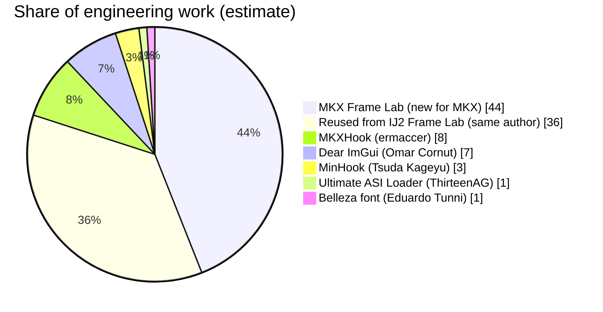

# MKX Frame Lab

Live frame data, hitboxes and hurtboxes for **Mortal Kombat X** (PC, Steam) Practice mode.

> **Practice mode only.** The overlay and every input feature turn themselves off in any other game mode. Never use mods online.

Download the ready-to-use build from [Nexus Mods](https://www.nexusmods.com/mortalkombatx). This repository is the source code.

## Features

- A frame data panel styled after the game's own move list: start-up, active, recovery, hit/block advantage, cancel and total, all measured live.
- The game's official move-list data for every normal, string, special, EX move and X-ray of both loaded characters, read from memory and shown in pad notation next to the measured values.
- Knockdown advantage, including frame kills: a follow-up done while the opponent is still on the ground (Predator F4 > Low Trap) updates the advantage to what is left at wake-up.
- Projectiles and traps keep the result open until they land, and gaps in strings and block strings are shown in frames.
- Hitboxes drawn exactly where the game's own hit test checks them, on the frames they are live: strike spheres, shaped attacks (cylinders, boxes, beams) and projectiles. Hurtboxes for both fighters.
- MKX tests hits in 2D, along the line between the fighters. Every shape is drawn on that line, so if two shapes touch on screen, the attack hits.
- Hitbox linger, opacity sliders, filled or outline drawing, freeze and frame-step, HDR-safe screenshots and an optional input buffer.
- A controller-friendly F2 menu styled after the game's pause menu, with a quick-reference card.

### How the hitboxes are read

MKX checks attacks in two ways:
- **Strike spheres** on the attacker's bones, tested against the defender's hurt spheres by `CollideSpheres2DOnTightRope`: a 2D sphere test on the fight line.
- **Collision objects** (shaped attacks, projectiles, traps) tested by `CollisionObj::CheckCollisionAgainstCharacter`, which hands the shape to a sphere, cylinder or box test in 2D or 3D.

MKX Frame Lab hooks those functions and records exactly the shape and size the game tested on each frame. Shapes are drawn only on the frames the game actually tests them, so an attack object that waits for its active frames or lingers after it connected is not shown as a live hitbox. This was checked by logging, on every tested frame, the gap between the drawn shapes and the opponent's hurtboxes next to the game's own verdict: every hit had the shapes overlapping and every whiff had a gap.

### How the frame data is measured

- **Start-up, active and recovery** come from the fighter's state on every game frame, split on the game's own attack hash so buffered and canceled moves are measured separately.
- **Advantage** is the difference between the frames both fighters can act again. Knockdowns are counted to the opponent's wake-up, as the game's move list does.
- **Move-list data** is read from the AI attack table every fighter carries (`AICharacterSensoryInfo`), the same data the in-game move list shows, and matched to the measured move by its attack hash.

## Building

Requirements: CMake 3.16+ and a 64-bit C++17 compiler.

- **MinGW-w64** (the toolchain the releases are built with), cross-compiling from Linux:
  ```
  cmake -B build -DCMAKE_TOOLCHAIN_FILE=cmake/mingw-w64-x86_64.cmake -DCMAKE_BUILD_TYPE=Release
  cmake --build build -j
  ```
- **Visual Studio 2022** (x64) should also work but hasn't been tested yet:
  ```
  cmake -B build -A x64
  cmake --build build --config Release
  ```

The build produces two files:

| File | What it is |
|---|---|
| `MKXFrameLab.asi` | A small loader picked up by [Ultimate ASI Loader](https://github.com/ThirteenAG/Ultimate-ASI-Loader). |
| `MKXFrameLab_core.dll` | The mod itself. The loader can hot-reload it (Ctrl+F5) without restarting the game. |

Copy both, plus `dist/MKXFrameLab.release.ini` renamed to `MKXFrameLab.ini`, into `Mortal Kombat X\Binaries\Retail`.

## Source layout

| File | Purpose |
|---|---|
| `src/loader.cpp` | The `.asi` loader and hot reload |
| `src/dllmain.cpp` | DX11 Present hook, ImGui setup and theme, window/input hooks |
| `src/mkx.cpp` | Game integration: players, hurt and strike spheres, collision objects and their hit tests, the fight plane, game mode, freeze/step, practice-mode controls |
| `src/game.cpp` | Frame meter, move segmentation, advantage, knockdowns and frame kills, gaps, move identification |
| `src/movelist.cpp` | Reads the game's attack tables and move lists and turns them into pad notation |
| `src/ui.cpp` | Frame data panel, F2 menu, quick-reference card, advanced window |
| `src/boxes.cpp` | Hitbox and hurtbox drawing, linger |
| `src/buffer.cpp` | XInput hook: optional input buffer, menu input capture |
| `src/dinput_block.cpp` | Blocks keyboard input to the game while the menu is open |
| `src/screenshot.cpp` | Back-buffer PNG screenshots |
| `src/bot.cpp`, `src/trace.cpp` | Scripted test input and hardware data-breakpoint traces (command file), practice mode only |
| `src/font_belleza.h` | The Belleza font, embedded for the menus and panel |
| `tools/sweepgen.py`, `tools/sweepreport.py` | Test tools: build a script that performs every move of a character and summarise the hitbox and frame data checks from the log |

## Third-party code and credits

| Credit | Project | How MKX Frame Lab uses it | Licence |
|---|---|---|---|
| [ermaccer](https://github.com/ermaccer) | [MKXHook](https://github.com/ermaccer/MKXHook) | The reference for the game's core systems (game tick, GameInfo, player and object lookup, positions, camera, game speed) and the freeze-world hook behind freeze / frame-step, in `src/mkx.cpp`. | - |
| [ThirteenAG](https://github.com/ThirteenAG) | [Ultimate ASI Loader](https://github.com/ThirteenAG/Ultimate-ASI-Loader) | Loads the mod into the game. Required, but not included. | MIT |
| [Omar Cornut](https://github.com/ocornut) | [Dear ImGui](https://github.com/ocornut/imgui) | The overlay UI: frame data panel, menus, drawing. Included in `external/imgui`. | MIT |
| [Tsuda Kageyu](https://github.com/TsudaKageyu) | [MinHook](https://github.com/TsudaKageyu/minhook) | Hooks the game's rendering, input and hit-test functions. Included in `external/minhook`. | BSD 2-clause |
| [Eduardo Tunni](https://github.com/etunni) | [Belleza](https://github.com/etunni/belleza) | The menu and panel font, embedded in `src/font_belleza.h`. Licence in `dist/OFL-Belleza.txt`. | SIL OFL 1.1 |

The licences of the included libraries are in their folders.

MKX Frame Lab is a port of [IJ2 Frame Lab](https://github.com/Pluralmite/IJ2FrameLab) by the same author, and a sibling of [MK11 Box Lab](https://github.com/Pluralmite/MK11BoxLab). It started as a copy of IJ2 Frame Lab's code base.

## Contributions

How much of MKX Frame Lab is original work, and how much comes from the projects it builds on. The pie chart is an **estimate** of engineering work by area, not a measurement. The [line counts](#lines-of-code) further down are measured.

MKX Frame Lab's own share is split in two:
- Code reused from IJ2 Frame Lab, the earlier project by the same author.
- New work for MKX.

Both were built by Pluralmite with Claude, as described in [AI usage](#ai-usage).



### How the estimate was made

The mod was split into five areas, each weighted by how much of the work it represents. Each area was then divided between the new MKX work, code reused from IJ2 Frame Lab, and the projects it uses.

| Area | Weight | From other projects | Reused from IJ2 Frame Lab | New for MKX |
|---|---|---|---|---|
| Game integration and hit-test research: finding the game's functions and data, strike spheres, collision objects and their hit tests, the fight plane, the attack tables | 40% | MKXHook 8% | 8% | 24% |
| Frame data engine: move segmentation, advantage, knockdowns and frame kills, projectiles, gaps, move-list matching | 20% | None | 12% | 8% |
| Overlay UI: frame data panel, F2 menu, quick-reference card, hitbox / hurtbox drawing, screenshots | 20% | Dear ImGui 7%, Belleza 1% | 5% | 7% |
| Testing tools: scripted input, practice-mode controls, traces, hit-gap logging, move sweep | 10% | None | 5% | 5% |
| Hooking, input and loading: hooks, input buffer, menu input capture, keyboard block, hot reload | 10% | MinHook 3%, Ultimate ASI Loader 1% | 6% | 0% |
| **Total** | **100%** | **20%** | **36%** | **44%** |

### Each project

**MKX Frame Lab, new for MKX (about 44%)**
- The game research in `src/mkx.cpp`. It covers:
  - The collision classes, found through their vtables and RTTI names.
  - The strike-sphere test and the fight plane it runs on.
  - `CollisionObj::CheckCollisionAgainstCharacter` and its sphere, cylinder and box sub-tests.
  - The AI attack tables, the attack hash and the move lists of every fighter.
  - The practice-mode controls (reset, settings) used by the test tools.
- Hooking the hit tests to record exactly what the game tested each frame, and drawing only those frames.
- MKX frame data: the move-list formulas, splitting moves on the attack hash, projectile and trap results, knockdown frame kills.
- The MKX-styled frame data panel, F2 menu and quick-reference card.
- New test tools: hit-gap logging, in-sequence screenshots, the move sweep.

**Reused from IJ2 Frame Lab (about 36%)**
- MKX Frame Lab started as a copy of IJ2 Frame Lab, which uses the same NetherRealm engine. Reused unchanged or adapted:
  - The loader and hot reload.
  - The DirectX 11 / ImGui overlay setup.
  - The frame meter, advantage and knockdown logic.
  - The input buffer, input capture and the keyboard block.
  - Screenshots, sphere drawing and the scripted test harness.
  - Much of the game-integration plumbing (object tracking, snapshots, freeze / step).
- Same author, so this is still Pluralmite's own work. It is shown separately to be clear about what was built for MKX.

**MKXHook by ermaccer (about 8%)**
- MKXHook was the reference for the game tick (`MKProcDispatch`), GameInfo, player lookup, positions, camera and game speed.
- The freeze-world hook behind F5 / F6 is ported from MKXHook's `HookDispatch`.
- These are only a few dozen lines, but the rest of the mod depends on them to find the players and run every frame. That is why they are weighted far above their line count.

**Dear ImGui by Omar Cornut (about 7%)**
- The toolkit every window, menu, slider and shape is drawn with, including its DirectX 11 and Win32 backends.
- Counted as about 35% of the overlay UI area. The panel layout, MKX styling and box drawing are this project's own code built on top of it.

**MinHook by Tsuda Kageyu (about 3%)**
- The library that installs every hook: the game's functions, DirectX Present, XInput and the window procedure.
- Counted as about 30% of the hooking and input area. What each hook does is this project's code.

**Ultimate ASI Loader by ThirteenAG (about 1%)**
- Loads `MKXFrameLab.asi` into the game.
- It is not included in the mod, but the mod needs it to run.

**Belleza font by Eduardo Tunni (about 1%)**
- The font used by the menus and panel, chosen because it is close to MKX's own menu font.

### Lines of code

Non-blank source lines compiled into the mod:

| Project | Lines | Share |
|---|---|---|
| Dear ImGui | 47,635 | 82.6% |
| MKX Frame Lab | 7,037 | 12.2% |
| &nbsp;&nbsp;of which shared with IJ2 Frame Lab | about 5,400 | |
| &nbsp;&nbsp;of which new or changed for MKX | about 1,700 | |
| MinHook | 2,949 | 5.1% |
| MKXHook (signatures and hook, inside `src/mkx.cpp`) | about 20 | 0.03% |
| Belleza font | font file, not code | n/a |
| Ultimate ASI Loader | Ships separately | n/a |

Line count favours large general-purpose libraries and undercounts small but essential pieces like the MKXHook signatures. It also says nothing about the hit-test and frame data research, which took most of the new work but fits in a few hundred lines. That is why the chart above uses the weighted estimate instead.

## AI usage

MKX Frame Lab was built with heavy use of AI. Pluralmite came up with the project, directed it and tested it. Claude, Anthropic's AI model, did most of the hands-on work, running as an agent with access to the game folder.

### What Claude did

- **Wrote the code:** ported IJ2 Frame Lab to MKX and wrote the new MKX code in `src/`.
- **Found the game data and functions the mod uses:** probed the running game with diagnostic builds and the scripted test harness in `src/bot.cpp`, and disassembled `MK10.exe`. This covers:
  - The strike-sphere and collision-object hit tests and their shapes.
  - The fight plane.
  - The attack tables, attack hash and move lists.
  - The practice-mode controls used for testing.

  The core game-tick, player and freeze references came from MKXHook, as described in [Contributions](#contributions).
- **Tested and fixed:** built test versions, hot-reloaded them into the game, took frame-by-frame screenshots, logged hit gaps and fixed the bugs found. Examples are Sektor's F2,1,2 block advantage, Sektor's 2,1,2 flame hitbox being shown before and after its active frames, and Predator's F4 > Low Trap knockdown advantage.
- **Wrote and published the documentation and release:** this README, the release README and the Nexus description. Claude also packaged the release and set up this repository and the Nexus page.
- **Produced the contributions estimate** above.

### What Pluralmite did

- Came up with the idea and decided what the mod should do.
- Played and tested the builds in-game. Reported what was wrong, such as Sektor's F2,1,2 block data, the 2,1,2 hitbox and the knockdown advantage after a trap.
- Made the design decisions: the IJ2 Frame Lab feature set, practice mode only, the MKX look, how gaps are shown and making it open source.
- Reviewed and published the release.

### Accuracy

The numbers and shapes the mod shows are not generated by AI. They are read live from the running game, from the same functions and tables the game uses. AI wrote the code that reads them, and it was checked against real hits, whiffs and the in-game move list.

## Licence

[MIT](LICENSE). Copyright (c) 2026 Pluralmite.
